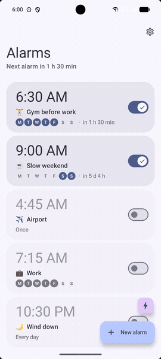
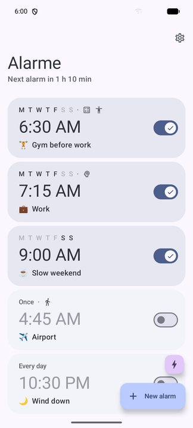
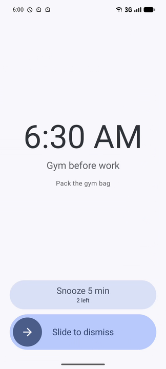
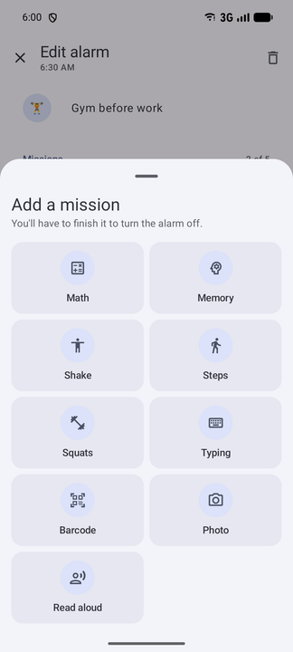
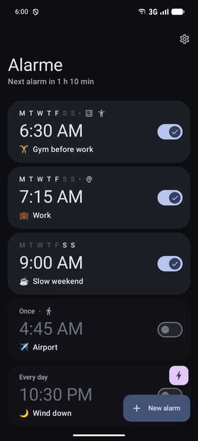
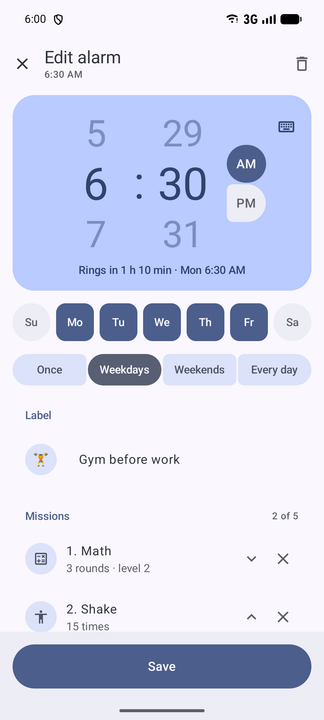
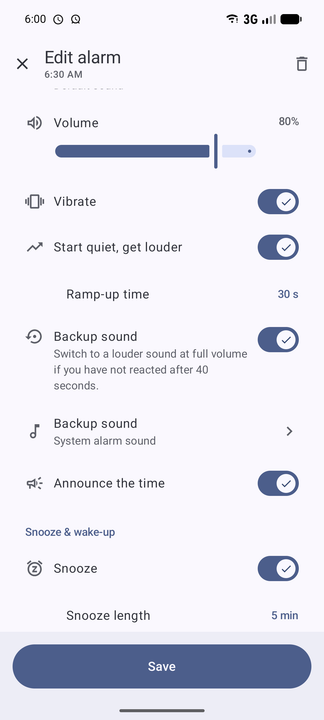
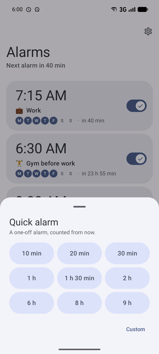

<div align="center">

# Alarme

### The alarm clock that actually gets you up.

A free, private, open-source Android alarm clock with wake-up missions, a wake-up check and anti-cheat protection.<br>
No ads, no analytics, no network permission, no paywall.

[](https://github.com/ducng99/alarme/releases/latest)
[](LICENSE)
[](#install)

[Download the APK](https://github.com/ducng99/alarme/releases/latest) · [Landing page](https://ducng99.github.io/alarme/) · [Report an issue](https://github.com/ducng99/alarme/issues)

<br>



<sub>Real recording: math, then shake, then you are free.</sub>

<br>






</div>

Alarme makes you prove you are awake. Solve math, scan the barcode in your bathroom, do squats or walk a few steps before it goes quiet. It is built to ring reliably, even through Do Not Disturb, a reboot or a locked screen.

## Features

<div align="center">
<table>
<tr>
<td align="center"><br><sub><b>Set the time and repeat days</b></sub></td>
<td align="center"><br><sub><b>Crescendo, backup sound, spoken time</b></sub></td>
<td align="center"><br><sub><b>Quick alarms for naps</b></sub></td>
</tr>
</table>
</div>

- **Rings on time, every time.** Exact AlarmManager alarms that survive reboots, time-zone changes, app updates and even a reboot before you unlock.
- **Gentle, then serious.** Start quiet and ramp up, then switch to a louder backup sound if you have not reacted within the delay you choose.
- **Wake-up check.** Rings again after you dismiss, to make sure you actually got up.
- **Snooze with limits.** Pick the snooze length and how many times you are allowed to snooze.
- **Skip once.** Day off tomorrow? Skip the next occurrence without turning the alarm off.
- **Quick alarms.** A one-off alarm counted from now, set in two taps. Perfect for naps.
- **Your sounds.** Bundled tones, device ringtones, imported songs or a recorded voice memo, or shuffle them.
- **Spoken memo.** Show a memo while the alarm rings and have the time and memo read aloud.
- **Home screen widget.** See the next alarm and how long until it rings at a glance.
- **Through Do Not Disturb.** Alarms sound even with Do Not Disturb on, right over the lock screen.
- **Material You.** A Material 3 design that follows your wallpaper colours, in light and dark.
- **Local backup.** Export alarms and your own sounds to a single file and restore them on a new phone.

### Wake-up missions

Chain up to five missions per alarm. The alarm keeps ringing until every one is done.

| Mission | What it asks of you |
|---|---|
| **Math** | Solve arithmetic, from multiple choice up to six keypad difficulty levels |
| **Memory** | Remember the highlighted tiles and tap them back on grids up to 7 × 7 |
| **Shake** | Shake the phone the given number of times |
| **Steps** | Get out of bed and walk, counted by the hardware step counter |
| **Squats** | Do squats while holding the phone, verified with the light sensor |
| **Typing** | Type motivational, study or your own sentences exactly |
| **Barcode** | Scan a barcode somewhere far from your bed, like the toothpaste in the bathroom |
| **Photo** | Take a photo of a place away from your bed |
| **Read aloud** | Say the shown words out loud, checked by on-device speech recognition |

## Install

Alarme is not on any app store. Install the signed APK straight from GitHub releases.

1. Download the latest `alarme-<version>.apk` from the [releases page](https://github.com/ducng99/alarme/releases/latest).
2. Open the file on your phone and allow installing from your browser or file manager.
3. Follow the short setup, which walks you through the permissions Android needs for alarms to ring on time.

Requires Android 15 (API 35) or newer.

## Building from source

Requirements: JDK 17, Android SDK with platform 37 and build-tools 36.0.0, and `ANDROID_HOME` pointing at the SDK.

```bash
./gradlew :app:assembleDebug                 # debug APK (pseudo-locales enabled)
scripts/gate.sh                              # ktfmtCheck + detekt + lintDebug + testDebugUnitTest
./gradlew ktfmtFormat                        # auto-format Kotlin
./gradlew :app:connectedDebugAndroidTest     # instrumented tests (device or emulator required)
./gradlew :app:assembleRelease               # R8 full mode + resource shrinking
```

Release builds read signing details from an untracked `keystore.properties` (`storeFile`, `storePassword`, `keyAlias`, `keyPassword`). Without it the release build falls back to the debug key so `assembleRelease` still produces an installable APK. The release workflow derives `versionName` and `versionCode` from a `vX.Y.Z` git tag and publishes the signed APK plus the R8 `mapping.txt`.

Unit tests are JVM tests. Android modules use `testDebugUnitTest`, the pure JVM modules (`:core:model`, `:core:common`) use the plain `test` task.

```bash
./gradlew :core:alarm-engine:testDebugUnitTest
./gradlew :feature:alarmlist:testDebugUnitTest --tests "*AlarmListViewModelTest*"
./gradlew :core:model:test --tests "dev.tomng.alarme.core.model.scheduling.*"
```

## How it is built

Kotlin, Jetpack Compose with Material 3, Hilt, Room, DataStore, Media3, CameraX, ZXing and Glance. The app has no network permission by construction.

| Module | Responsibility |
|---|---|
| `app` | Activity, top-level navigation, Hilt glue, manifest, release config |
| `core/model` | Pure Kotlin: alarms, missions, scheduling math, backup payloads |
| `core/common` | Pure Kotlin: clock and dispatcher abstractions |
| `core/data` | Room database, DataStore settings, repositories, skip and ring-event logic |
| `core/designsystem` | Material 3 theme and dynamic colour |
| `core/alarm-engine` | AlarmManager scheduling, receivers, foreground services, notifications, power-off and uninstall blockers, the ring state machine |
| `core/audio` | Players, volume lock, crescendo, TTS, vibration, audio focus |
| `core/sensors` | Shake, squat/cover and step-counter trackers |
| `feature/*` | Compose screens and ViewModels: `alarmlist`, `editor`, `missions`, `ring`, `ringtones`, `settings`, `backup`, `widget` |

The ring path is the heart of the app. `AlarmSchedulerImpl` arms alarms with `AlarmManager.setAlarmClock`, validated broadcast receivers feed `RingDeliveryDispatcher`, and a foreground `AlarmService` starts the ring session. `RingStateMachine` is a pure reducer: every event carries `now`, every asynchronous action leaves as a `RingEffect`, and `RingEffectExecutor` is the only Android-touching consumer. Tests live next to that reducer rather than in the UI.

The landing page in `docs/` is an Astro site deployed to GitHub Pages.

## License

MIT. See [LICENSE](LICENSE).
